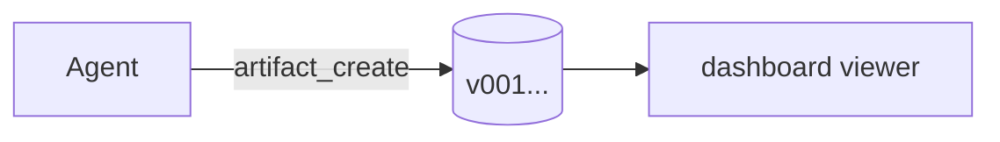
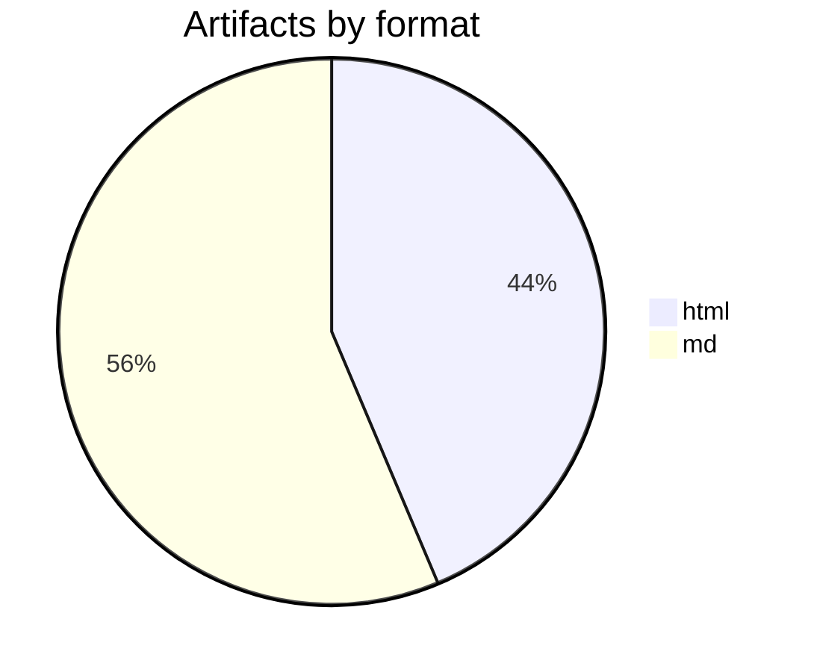

# Authoring markdown/mdx artifacts — complete reference

You (the agent) write a document. The artifact dashboard renders it in a
built-in viewer. You never generate HTML for documents, never ship a render
setup, never write files by hand — you call the tools (see SKILL.md) and the
viewer does the rest.

**Before writing mdx, call `artifact_capabilities`** (omp tool) or
`artifact capabilities --json` (CLI): same data as this page, always in sync
with the installed version.

## The contract (hard rules)

1. **Component props must be literals.** Strings `"…"`, numbers, booleans,
   and inline JSON arrays/objects. The viewer executes no code, so
   `data={sales}` (a variable reference) renders as a placeholder box, never
   a chart. **Inline your data**: `data={[{ name: "Q1", sales: 12 }]}`.
2. **Components sit on their own lines** (block-level, may be indented).
   Inline JSX in the middle of a paragraph is not a component call.
3. **No `import`/`export` statements** — they are useless here and hidden
   from the reader. Same for `{/* expression comments */}`.
4. **Unknown components never crash** — they render as a visible placeholder
   `⟨Tag⟩` so readers see something belongs there. Don't invent components:
   use the built-ins below or plain markdown.
5. **Container children are markdown** — `Callout`, `Stats`, `Section`, `Card`,
   `Cards` and `Carousel` support prose and nested components.
6. Lowercase HTML tags (`<details>`, `<b>`) pass through as normal markdown
   HTML; capitalized tags are components.
7. **Native inline SVG is supported in MDX.** Put a lowercase `<svg>` block
   outside code fences, using quoted XML attributes. The viewer validates
   static SVG and removes active content; this is not a JSX execution engine.

## Relevance filter — apply BEFORE any visual

Components and diagrams are **information tools, not decoration**. The
default document is prose; a visual must do work text cannot.

**A diagram earns its place only when it shows structure**: 3+ interacting
steps or actors, architecture with relations, state transitions, branching
decisions. Otherwise skip it: linear steps → numbered list, comparison →
table, everything else → prose.

**A chart requires REAL data** — numbers you actually have from the
conversation, the repo, or the task. **Never invent plausible numbers to
justify a chart.** No real data → no chart.

Hard limits: **one diagram per document** (unless the document is itself
architecture/flow documentation), and if the surrounding text has to explain
the visual, the visual should not exist.

| Need | Format |
| --- | --- |
| Notes, reports, specs, any prose | `mdx` preferred; `md` remains compatible for plain prose |
| Same + a visual that passed the filter above | `mdx` |
| Long content with distinct topics | sibling `.mdx` pages + `Pages`; headings provide within-page navigation |
| Truly interactive / self-contained page | `html` (last resort) |

| Graphic need | Use |
| --- | --- |
| Measured categories or trends | `Chart` with verified numeric values and units |
| A few simple nodes or relations | `Svg shapes={[...]}` |
| Detailed architecture, nested groups, routed arrows and multiline text | native `<svg>…</svg>` |
| Exact values or many fields | `Table` or a Markdown table |

Do not turn an architecture diagram into invented chart metrics. Outline
verified actors/systems and the owner of truth, then place boxes before
routing labeled arrows around text. Separate different units into different
charts. The numerical datasets in this reference are illustrative examples,
not production metrics.


## Sections index (md and mdx, automatic)

Every `##` / `###` heading gets an anchor id (accents stripped:
`Qué es` → `#que-es`). With **3+ headings** the viewer shows a
**Secciones sidebar** (sticky + scroll-spy on desktop, stacked on
mobile) with a **search box filtering entries** — everything authors keep
adding via `##` appears there, so readers jump around long documents.
Short docs keep the single-column
look. One `#` title per document; `##` for sections, `###` for
subsections.

## Sibling files & sub-routes — the folder standard

An artifact is a **folder**. Files next to `index.mdx` are first-class:

```
docs/artifacts/un-artifact/
├── index.mdx        # entry (versioned via artifact_create)
├── asset.png        # 
├── logo.svg         # inline by relative path
├── clip.mp4         # <Video src="clip.mp4" />
├── nota.mp3         # <Audio src="nota.mp3" />
├── other.html       # sub-route; embed with <Webframe src="other.html" />
└── other.md         # [notes](other.md) → renders as a viewer sub-route
```

- Reference siblings by **relative path only** — the viewer URL makes them
  resolve. Never absolute/external URLs for local files.
- Agents attach bytes with `artifact_asset` (name may be a subpath like
  `shots/01.png`; bytes live in the store, served at
  `/artifacts/<slug>/<name>`). You may also drop or symlink a folder into
  `docs/artifacts/<slug>/` — the daemon serves whatever it finds.
- `Webframe` (web viewer component): props `src` (required, relative),
  `title?`, `height?` (160-720, default 360). Browser-chrome embed of a
  sibling HTML — ideal for wireframes and mock pages inside a document.

## Frontmatter (both md and mdx)

```yaml
---
title: Release Notes Q3        # sidebar label; fallback: first # heading
type: study                    # generic (default) | study | wireframe (sidebar badge)
---
```

## Built-in components

### `Chart` — real chart (rendered with recharts)

```mdx
<Chart
  type="bar"
  title="Illustrative revenue and costs by quarter (k USD)"
  data={[
    { name: "Q1", revenue: 12.0, costs: 2.1 },
    { name: "Q2", revenue: 12.8, costs: 1.9 },
    { name: "Q3", revenue: 14.9, costs: 1.4 },
  ]}
  series={["revenue", "costs"]}
/>
```

| Prop | Required | Type | Default | Notes |
| --- | --- | --- | --- | --- |
| `data` | yes | array of objects | — | one object per point; one string key (x axis) + numeric keys |
| `type` | no | `"bar" \| "line" \| "area" \| "pie"` | `"bar"` | |
| `x` | no | string | `"name"` | which key is the category axis |
| `series` | no | array of strings | all numeric keys (max 4) | which keys to plot; pie uses the first |
| `title` | no | string | — | small caption above the chart |
| `height` | no | number | `240` | px, clamped to 160–480 |

- Charts are **static renders** (no hover tooltips) and follow the dashboard
  theme automatically.
- Pie: values come from `series[0]` (or the first numeric key), labels from `x`.
- Use finite numbers, not `"12k"` or `"40%"`; put units in the title.
  Input order is preserved: sort time data before authoring. Prefer 1–4
  compatible-unit series; the default infers up to four from the first row.

### `Stats` + `Stat` — KPI grid

```mdx
<Stats>
  <Stat value="14.9k" label="MRR" delta="+24%" />
  <Stat value="1.4%" label="Churn" delta="-0.5pp" />
  <Stat value="72" label="Sessions" />
</Stats>
```

| Component | Prop | Required | Notes |
| --- | --- | --- | --- |
| `Stat` | `value` | yes | main figure (string) |
| `Stat` | `label` | no | small uppercase caption |
| `Stat` | `delta` | no | starts with `+` → green, `-` → red |
| `Stats` | children | yes | the `<Stat />` cells; responsive grid |

### `Callout` — highlighted note

```mdx
<Callout type="warning" title="Props must be literals">
  `data={sales}` does **not** work — write `data={[{ name: "Q1", sales: 12 }]}`.
</Callout>
```

| Prop | Required | Notes |
| --- | --- | --- |
| `type` | no | `info` (default) \| `warning` \| `success` \| `danger` — picks color |
| `title` | no | bold heading |
| children | no | **markdown body** (bold, lists, links, code) |

### `Section` — named card section (joins the Secciones index)

```mdx
<Section title="Cierre de jornada" subtitle="Qué tiene que pasar en la operación">
  Prose, lists, even `<Chart />` or `<Svg />` inside.
</Section>
```

| Prop | Required | Notes |
| --- | --- | --- |
| `title` | yes | card heading; becomes the `#anchor` (accents stripped) |
| `id` | no | custom anchor, e.g. `id="cierre"` → `#cierre` |
| `subtitle` | no | muted line under the heading |
| children | no | **markdown body** |

### `Svg` — declarative vector graphic (no hand-written markup)

Describe boxes, circles, arrows, lines and texts as literal data:

```mdx
<Svg
  title="Vende · Cobra · Controla"
  shapes={[
    { type: "box", x: 10, y: 50, w: 150, h: 70, label: "Vende", sub: "en ruta", color: "blue" },
    { type: "arrow", x1: 160, y1: 85, x2: 210, y2: 85 },
    { type: "box", x: 210, y: 50, w: 150, h: 70, label: "Cobra", sub: "por cliente", color: "green" },
  ]}
/>
```

| `type` | Coords | Extras |
| --- | --- | --- |
| `box` | `x`, `y`, `w`, `h` | `label?`, `sub?`, `color?` |
| `circle` | `cx`, `cy`, `r` | `label?`, `color?` |
| `arrow` | `x1`, `y1`, `x2`, `y2` | `label?`, `dashed?` |
| `line` | `x1`, `y1`, `x2`, `y2` | `label?`, `dashed?` (no arrowhead) |
| `text` | `x`, `y`, `text` | `size?` (9–28), `anchor?` (`middle`/`start`/`end`) |

Canvas `width?` (240–860, default 640), `height?` (120–520, default
220), `title?`. Colors: `blue` (default), `green`, `yellow`, `red`,
`purple`, `teal`, `gray`. Max 40 shapes. Same relevance filter as
charts: real structure from the document, never invented content.

### Native inline SVG — detailed diagrams

For detailed architecture, put real SVG directly inside the MDX document:

```mdx
<svg viewBox="0 0 640 180" role="img" aria-labelledby="diagram-title">
  <title id="diagram-title">Application → source system</title>
  <defs>
    <marker id="arrow" viewBox="0 0 10 10" refX="9" refY="5" markerWidth="7" markerHeight="7" orient="auto">
      <path d="M0 1 L9 5 L0 9 Z" fill="var(--muted)" />
    </marker>
  </defs>
  <g fill="var(--code-bg)" stroke="var(--border)">
    <rect x="20" y="40" width="230" height="90" rx="12" />
    <rect x="390" y="40" width="230" height="90" rx="12" />
  </g>
  <g fill="var(--fg)" font-size="18" text-anchor="middle">
    <text x="135" y="88">Application</text>
    <text x="505" y="88">Source system</text>
  </g>
  <path d="M250 85 H386" stroke="var(--muted)" stroke-width="2" marker-end="url(#arrow)" fill="none" />
</svg>
```

Remove the code fence to render the diagram. SVG can also be a child of
`Card` or `Section`. Use `<g>` for layers, `<path>` for routed connectors,
`<defs>/<marker>` for arrowheads and `<tspan x="..." dy="...">` for
multiline text. For three lanes, prefer a 960–1,200 unit `viewBox` and
readable 16–20 unit labels; split a very dense diagram into focused pages.
Add `title/desc` and accessible references, use viewer palette variables,
and explain any color/dashed-line meaning with text.

IDs and local references are namespaced automatically. Expanded diagrams
keep their natural canvas width and can be scrolled; the close control,
Escape and backdrop return to the page.

Only static SVG is supported: quoted attributes, no JSX expressions or
style objects. Scripts, events, foreign HTML, stylesheet blocks, animation
and remote resource URLs are filtered. `<use>` may reference only local
primitive shapes without element children; expand group/symbol references
into explicit geometry. Invalid XML, DTD/entities and over-limit input fail
visibly. Limits: 512 KiB, 2,048 elements, 40 levels, canvas sides up to 4,096.

### Cards, carousels, tables and pages

```mdx
<Pages items={[{ title: "Overview", href: "index.mdx" }, { title: "Details", href: "details.mdx" }]} />
<Cards columns={2}>
  <Card title="Source diagram" asset="images/diagram.svg" alt="Architecture diagram">Verified supporting content.</Card>
  <Card title="Notes">Markdown content and nested built-ins.</Card>
</Cards>
<Carousel title="Views" perView={2}>
  <Card title="Front" asset="images/front.webp" />
  <Card title="Back" asset="images/back.webp" />
</Carousel>
<Table title="Sources" columns={["File", "Format"]} rows={[["index.mdx", "MDX"], ["details.mdx", "MDX"]]} />
```

`Card`: optional `title/subtitle/asset/assetType/alt` and Markdown children.
Assets are document-relative or HTTPS; media type is inferred from extension
or specified as `image|video|audio|file`. `Cards columns` is 1–4.
`Carousel perView` is 1–3 (mobile: one), with keyboard navigation and no
autoplay. `Table` accepts labels/keyed columns and scalar array/object rows,
or Markdown table children, not both; 24 columns, 500 rows, 4,096 characters
per cell. `Pages` accepts 1–50 unique `{ title, href, description? }` entries.

Plan pages by coherent topic: `index.mdx` is a concise overview; named sibling
`.mdx` files carry chapters/appendices. Repeat the same literal `Pages` map
on each flat sibling page and give each a clear heading. Use
`artifact_create/update` for the versioned entry and `artifact_asset` for
sibling pages/assets, which are not independently versioned. Linked files
must actually exist. Read the current page's source from Copy for agent.


### `Video` / `Audio` — native playback (sibling file or https URL)

```mdx
<Video src="clip.mp4" title="Demo de la ruta" poster="thumb.png" />
<Audio src="nota.mp3" title="Resumen en audio" />
```

| Prop | Required | Notes |
| --- | --- | --- |
| `src` | yes | sibling path (`clip.mp4`) or `https://` URL; `javascript:`/`data:`/`blob:`, `..` and absolute paths render as a placeholder |
| `title` | no | caption under (`Video`) / next to (`Audio`) the player |
| `poster` | no | `Video` only — cover image, same src rules as `src` |
| `controls` | no | default `true` |
| `autoplay`, `loop`, `muted` | no | default `false` (`autoplay` plays muted inline) |

Video: mp4, webm, ogv, mov, mkv. Audio: mp3, wav, ogg, m4a, aac, flac, opus.
Images stay plain markdown (`` or ``); links too
(`[text](other.md)`, `[text](https://…)`). `autoplay` always plays muted (browser policy).

## Diagrams — mermaid fences (md and mdx)

Any fenced block tagged `mermaid` renders as a diagram. No component, no props:

````mdx

````

Supported: flowchart, sequence, class, state, ER, gantt, pie, journey,
mindmap, gitGraph… (whatever the installed mermaid supports). Rendered
client-side; if scripts are unavailable the raw source stays visible.
Use mermaid when its notation fits the verified structure. Use native inline
SVG for precise architecture layouts, not ASCII art or invented chart data.

Pie labels **must be quoted** (`"md" : 31` — unquoted labels fail to parse):

````mdx

````

Every graphic — `Chart`, `Svg`, native SVG, mermaid — gets an **⤢ expand
button**. Click the same control, Escape or the backdrop to close it.

## Plain markdown you can rely on (GFM)

- Tables, task lists (`- [x]`), strikethrough, autolinks
- Fenced code with syntax highlighting (` ```ts `, ` ```py `…)
- Headings, lists, blockquotes, links, images (max-width constrained)
- The viewer applies dark/light theme — never hardcode colors in inline HTML

## Common mistakes

| You wrote | You'll see | Fix |
| --- | --- | --- |
| `data={sales}` | placeholder `⟨Chart /⟩` | inline the array literal |
| `<Chart />` mid-paragraph | literal text | own line, block-level |
| `disabled` (boolean shorthand) | placeholder | `disabled={true}` |
| `import Chart from …` | hidden line | built-ins need no imports |
| `<myWidget />` (lowercase) | inert HTML | capitalize or use built-ins |
| ASCII art diagram | ugly wall | mermaid fence |

## Copy-paste skeleton

Minimal on purpose — add visuals only when they pass the relevance filter,
using the examples above:

```mdx
---
title: Q3 Report
type: study
---

# Q3 Report

One-paragraph TL;DR with **key numbers**.

## Detail

Prose. A table if comparing, a numbered list for steps. One diagram ONLY if
there is real structure (3+ steps/actors), one chart ONLY with real data.

| Metric | Q2 | Q3 |
| --- | ---: | ---: |
| MRR | 12.0k | 14.9k |
```

Save it with the omp tools (never by hand):

```
artifact_create(slug="q3-report", title="Q3 Report", content=…, format="mdx")
```
