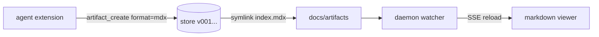
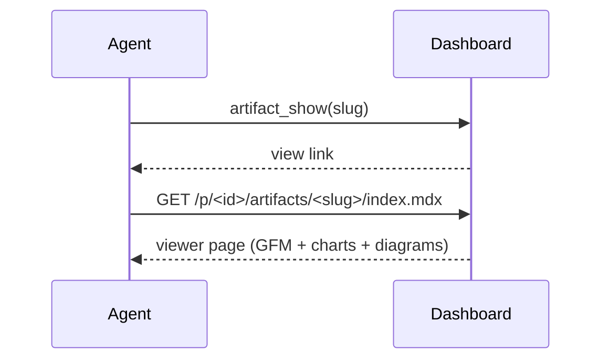
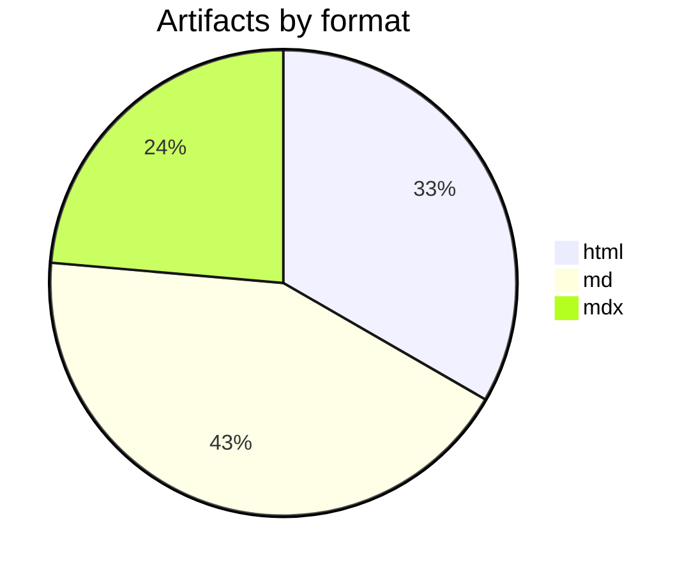

# MDX Guide

Everything you can put inside an `.mdx` artifact, rendered live by the
dashboard's built-in viewer. Save your document as
`docs/artifacts/<slug>/index.mdx` (or push it with `artifact_create` using
`format: "mdx"`) and it renders exactly like this page.

**The contract in one line:** props must be literals (strings, numbers,
booleans, JSON arrays/objects) — the viewer executes no code, so inline your
data instead of referencing variables.

<Callout type="info" title="Rule of thumb">
Documents, reports, notes → `.mdx` (plain Markdown still works). Add **charts,
cards, carousels, tables, KPIs or sections** only when they help explain the content.
</Callout>

<Callout type="warning" title="Relevance filter — apply before any visual">
Components are information tools, not decoration. **Default to prose.** A
diagram must show real structure (3+ interacting steps/actors, architecture,
states); a chart needs **real data — never invent numbers** to justify one.
One diagram per document, and if the text has to explain the visual, drop
the visual.
</Callout>

## Choosing the right graphic

| Question | Use | Why |
| --- | --- | --- |
| Compare measured values across categories | `Chart type="bar"` | makes magnitudes comparable |
| Show a measured trend over time | `Chart type="line"` or `area` | order the data chronologically |
| Explain a few boxes, steps or relations | `Svg shapes={[...]}` | simple, theme-aware declarative graphics |
| Explain a detailed architecture like people → application → source system | inline `<svg>…</svg>` | full control over groups, paths, markers and multiline text |
| Readers need exact values or many fields | `Table` / Markdown table | easier to inspect precisely |

**For agents:** start from facts in the task, repository or supplied reference.
Name the nodes and relationships before drawing. Do not invent architecture,
numbers, capabilities or integrations to make a diagram look complete.
Keep the overview short and move detailed graphics to a dedicated `Pages`
chapter when they make the entry page too dense.

The datasets below are **illustrative documentation examples**, not business
metrics. Replace them with verified data when authoring a real artifact.

## Charts — `Chart` (rendered with recharts)

`type` is one of `bar` (default), `line`, `area` or `pie`. `data` is an array
of objects: one key is the `x` axis (default `"name"`), the numeric keys are
the series (or pass `series: ["key", ...]` to pick them).

<Chart
  type="bar"
  title="Illustrative revenue and costs by quarter (k USD)"
  data={[
    { name: "Q1", revenue: 12.0, costs: 2.1 },
    { name: "Q2", revenue: 12.8, costs: 1.9 },
    { name: "Q3", revenue: 14.9, costs: 1.4 },
    { name: "Q4", revenue: 16.2, costs: 1.1 },
  ]}
  series={["revenue", "costs"]}
/>

Line charts for trends:

<Chart
  type="line"
  title="Weekly active agents"
  data={[
    { week: "W1", sessions: 38, agents: 12 },
    { week: "W2", sessions: 44, agents: 14 },
    { week: "W3", sessions: 51, agents: 17 },
    { week: "W4", sessions: 63, agents: 21 },
    { week: "W5", sessions: 72, agents: 26 },
  ]}
  x="week"
/>

Areas to emphasize volume:

<Chart
  type="area"
  title="Storage used (GB)"
  data={[
    { month: "Ene", store: 3.1 },
    { month: "Feb", store: 3.9 },
    { month: "Mar", store: 5.2 },
    { month: "Abr", store: 6.8 },
  ]}
  x="month"
/>

Pie for shares (the first numeric key is the value):

<Chart
  type="pie"
  title="Artifacts by format"
  data={[
    { format: "html", count: 24 },
    { format: "md", count: 31 },
    { format: "mdx", count: 17 },
  ]}
  x="format"
  height={260}
/>

Charts are **static server-side renders** (no hover tooltips) and follow the
dashboard theme automatically. Hover any chart for its **⤢ expand button**
to see it full-viewport.

### Authoring a numerical chart

1. Use one object per row and **finite numbers**, not formatted strings
   such as `"12k"` or `"40%"`. Put units and context in the title.
2. Select the category/time key with `x="key"` (default `"name"`).
   The renderer preserves input order; sort dates before writing the data.
3. Select numeric keys with `series={["key", ...]}`. Without it the first
   row's numeric keys are inferred, up to four by default. Prefer 1–4 series
   and separate incompatible units rather than plotting currency and rates
   on the same axis.
4. `height={240}` is optional, 160–480 pixels. Charts are static inline SVG,
   not an interactive chart application; the expand button exposes detail.
5. Props are literal data. `data={someVariable}`, callbacks and imported
   chart components are not evaluated by this viewer.


## KPIs — `Stats` + `Stat`

`Stat` takes `value`, `label` and an optional `delta` (`+`/`-` prefix picks
the color). Wrap several in `Stats` for a responsive grid.

<Stats>
  <Stat value="14.9k" label="MRR" delta="+24%" />
  <Stat value="1.4%" label="Churn" delta="-0.5pp" />
  <Stat value="72" label="Sessions" delta="+38%" />
  <Stat value="17" label="Artifacts" delta="+6" />
</Stats>

## Callouts — `Callout`

`type` is one of `info`, `warning`, `success`, `danger`; `title` is optional
and children are **markdown** (bold, links, lists — everything works).

<Callout type="warning" title="Props must be literals">
`data={sales}` does **not** work — the viewer never evaluates code.
Write `data={[{ name: "Q1", sales: 12 }]}` instead.
</Callout>

<Callout type="success" title="Versioning still applies">
Every save through `artifact_create` / `artifact_update` creates a new
`v00N` and hot-reloads this preview.
</Callout>

<Callout type="danger">
Default type is `info`; unknown types fall back to it too.
</Callout>

## Sections for long documents — headings + `Section`

Every `##` / `###` heading gets an anchor id automatically (accents
stripped: `Qué es` → `#que-es`, hover any heading for its `#` link).
When a document has **3 or more headings**, the viewer adds a
**Secciones sidebar**: sticky index on desktop, stacked card on mobile,
with scroll-spy highlighting where you are and a **search box to filter**
entries. Everything you keep adding
with `##` shows up there — no configuration, just keep writing markdown
and readers can jump around the document.
For a highlighted block with its own card, use `Section` (its title is a
regular `h2`, so it joins the sidebar too; children are **markdown**):

<Section title="Qué es (y para quién)" subtitle="El vertical base de Avileo">
  Prose, lists, even nested components — everything works in here.

  - **Modo técnico:** `businessMode: "distributor"`.
  - **Firma:** "Vende. Cobra. Controla."
</Section>

```mdx
<Section title="Cierre de jornada" subtitle="Qué tiene que pasar en la operación">
  Prose, lists, even <Chart /> or <Svg /> inside.
</Section>
```

| Prop | Required | Notes |
| --- | --- | --- |
| `title` | yes | card heading; becomes the `#anchor` (accents stripped) |
| `id` | no | custom anchor, e.g. `id="cierre"` → `#cierre` |
| `subtitle` | no | muted line under the heading |
| children | no | **markdown body** |

Tips: short docs (fewer than 3 headings) keep the current single-column
look — the sidebar only appears when the document is long enough to need
it. Prefer `##` for sections, `###` for subsections; one `#` title per
document.

## Declarative SVG graphics — `Svg`

For a simple diagram, describe boxes, circles, arrows and text as
**literal data**. For more detailed layouts, use the native inline SVG
section below. Neither mode evaluates authored JavaScript.

<Svg
  title="Vende · Cobra · Controla"
  shapes={[
    { type: "box", x: 10, y: 50, w: 150, h: 70, label: "Vende", sub: "en ruta", color: "blue" },
    { type: "arrow", x1: 160, y1: 85, x2: 210, y2: 85 },
    { type: "box", x: 210, y: 50, w: 150, h: 70, label: "Cobra", sub: "por cliente", color: "green" },
    { type: "arrow", x1: 360, y1: 85, x2: 410, y2: 85 },
    { type: "box", x: 410, y: 50, w: 150, h: 70, label: "Controla", sub: "pulso del día", color: "purple" },
  ]}
/>

```mdx
<Svg
  title="Vende · Cobra · Controla"
  shapes={[
    { type: "box", x: 10, y: 50, w: 150, h: 70, label: "Vende", sub: "en ruta", color: "blue" },
    { type: "arrow", x1: 160, y1: 85, x2: 210, y2: 85 },
    { type: "box", x: 210, y: 50, w: 150, h: 70, label: "Cobra", sub: "por cliente", color: "green" },
    { type: "arrow", x1: 360, y1: 85, x2: 410, y2: 85 },
    { type: "box", x: 410, y: 50, w: 150, h: 70, label: "Controla", sub: "pulso del día", color: "purple" },
  ]}
/>
```

Shape reference (all props are literals — coordinates are canvas pixels):

| `type` | Coords | Extras |
| --- | --- | --- |
| `box` | `x`, `y`, `w`, `h` | `label?`, `sub?` (second line), `color?` |
| `circle` | `cx`, `cy`, `r` | `label?`, `color?` |
| `arrow` | `x1`, `y1`, `x2`, `y2` | `label?` (midpoint tag), `dashed?` |
| `line` | `x1`, `y1`, `x2`, `y2` | `label?`, `dashed?` (no arrowhead) |
| `text` | `x`, `y`, `text` | `size?` (9–28), `anchor?` (`middle` default, `start`, `end`) |

Canvas: `width?` (240–860, default 640), `height?` (120–520, default
220), `title?` caption. Colors: `blue` (default), `green`, `yellow`,
`red`, `purple`, `teal`, `gray`. Labels follow the dashboard theme
automatically; at most 40 shapes per graphic.

A second pattern — milestones joined by a dashed connector:

<Svg
  title="Jornada del vendedor"
  height={160}
  shapes={[
    { type: "circle", cx: 60, cy: 70, r: 30, label: "1", color: "blue" },
    { type: "line", x1: 90, y1: 70, x2: 170, y2: 70, dashed: true },
    { type: "circle", cx: 200, cy: 70, r: 30, label: "2", color: "green" },
    { type: "line", x1: 230, y1: 70, x2: 310, y2: 70, dashed: true },
    { type: "circle", cx: 340, cy: 70, r: 30, label: "3", color: "purple" },
    { type: "text", x: 60, y: 125, text: "entrega" },
    { type: "text", x: 200, y: 125, text: "cobra" },
    { type: "text", x: 340, y: 125, text: "cierra" },
  ]}
/>

Same relevance filter as charts: a graphic must show real structure from
the document — never invent content to justify one.

## Native inline SVG — architecture diagrams

Place a lowercase `<svg>` block directly in MDX, **not in a code fence**.
It is rendered as a responsive, expandable vector graphic, including
inside `Card` or `Section`. Blank lines inside the SVG remain XML, not
Markdown paragraphs. This is a simplified three-lane architecture pattern:

<svg xmlns="http://www.w3.org/2000/svg" viewBox="0 0 960 380" role="img" aria-labelledby="architecture-title architecture-desc" font-family="system-ui, sans-serif">
  <title id="architecture-title">People, application and source system</title>
  <desc id="architecture-desc">Users interact with an application; its backend talks to a source system that owns the business state and returns events.</desc>
  <defs>
    <marker id="architecture-arrow" viewBox="0 0 10 10" refX="9" refY="5" markerWidth="7" markerHeight="7" orient="auto">
      <path d="M0 1 L9 5 L0 9 Z" fill="var(--muted)" />
    </marker>
  </defs>

  <g fill="var(--code-bg)" stroke="var(--border)" stroke-width="1.5">
    <rect x="20" y="55" width="185" height="90" rx="12" />
    <rect x="20" y="205" width="185" height="90" rx="12" />
    <rect x="300" y="25" width="325" height="280" rx="16" />
    <rect x="320" y="85" width="285" height="65" rx="10" />
    <rect x="320" y="185" width="285" height="90" rx="10" />
    <rect x="740" y="25" width="200" height="280" rx="16" />
    <rect x="758" y="85" width="164" height="65" rx="10" />
    <rect x="758" y="185" width="164" height="75" rx="10" />
  </g>
  <g fill="var(--fg)" text-anchor="middle" font-size="16">
    <text x="112" y="88" font-weight="700">User / partner</text>
    <text x="112" y="112" font-size="14">uses the application</text>
    <text x="112" y="238" font-weight="700">Customer</text>
    <text x="112" y="262" font-size="14">referred through a link</text>
    <text x="462" y="55" font-size="18" font-weight="700">APPLICATION</text>
    <text x="462" y="110" font-weight="700">UI / SDK</text>
    <text x="462" y="132" font-size="14">interaction and contracts</text>
    <text x="462" y="215" font-weight="700">Backend</text>
    <text x="462" y="238" font-size="14"><tspan x="462">Business rules</tspan><tspan x="462" dy="22">Reconciliation</tspan></text>
    <text x="840" y="55" font-size="16" font-weight="700">SOURCE SYSTEM</text>
    <text x="840" y="110" font-weight="700">API / adapter</text>
    <text x="840" y="132" font-size="14">source of truth</text>
    <text x="840" y="215" font-weight="700">Data / events</text>
    <text x="840" y="238" font-size="14">business state</text>
  </g>
  <g fill="none" stroke="var(--muted)" stroke-width="2" marker-end="url(#architecture-arrow)">
    <path d="M205 100 L315 115" />
    <path d="M605 205 C670 205 670 115 755 115" />
    <path d="M755 248 H610" />
    <path d="M205 250 H240 V330 H722 V252 H755" stroke-dasharray="6 4" />
  </g>
  <g fill="var(--muted)" font-size="14" text-anchor="middle">
    <text x="252" y="91">uses</text>
    <text x="678" y="160">server → server</text>
    <text x="678" y="237">events</text>
    <text x="480" y="355">direct action in the source system</text>
  </g>
</svg>

### Layout checklist for an architecture diagram

- Group actors, application layers and external systems into clear lanes.
  Label which system owns the truth; distinguish current facts from planned work.
- Lay out boxes first, then attach arrows at their edges. Use routed
  `<path>` curves/segments so arrows do not cross node titles or descriptions.
- Use `<g>` for shared presentation and `<tspan x="..." dy="...">` for
  multiline labels. Use short labels instead of shrinking text excessively.
- Prefer a 960–1,200 unit-wide `viewBox` for three lanes and 16–20 unit
  text. Use `<title>`, `<desc>` and `aria-labelledby` for accessibility.
- Define arrowheads/gradients once in `<defs>` and reference them with
  `url(#id)`. IDs and local references are namespaced per graphic, so
  multiple diagrams can reuse the same starter template safely.
- Use `var(--fg)`, `var(--muted)`, `var(--border)` and `var(--code-bg)` to
  follow the document theme. Use color and line styles consistently, with
  textual labels rather than color-only meaning.
- Expand a large SVG to read it at its natural canvas width and scroll
  horizontally if needed. Close with the same button, Escape or the backdrop.

Minimal starter (shown as code; remove the fence to render it):

```mdx
<svg viewBox="0 0 640 180" role="img" aria-labelledby="graphic-title">
  <title id="graphic-title">A source-backed diagram</title>
  <rect x="20" y="30" width="260" height="100" rx="12" fill="var(--code-bg)" stroke="var(--border)" />
  <text x="150" y="88" text-anchor="middle" font-size="18" fill="var(--fg)">Verified fact</text>
</svg>
```

**Literal XML contract:** use quoted attributes and standard SVG names
such as `viewBox`, `stroke-width` and `marker-end`. String-valued aliases
such as `strokeWidth="2"` are normalized, but `width={value}`,
`style={{...}}`, callbacks and imported JSX are not executed.
Static groups, shapes, paths, markers, gradients, clipping, masks, text and
sibling asset/page references are supported. Scripts, event handlers,
`foreignObject`, stylesheet blocks, animation and remote resource references
are removed. DTDs/entities, malformed XML and invalid/oversized canvases fail
visibly. Limits: 512 KiB, 2,048 elements, 40 nesting levels, and a positive
`viewBox` width/height up to 4,096.

`<use>` may reuse a local primitive shape (`path`, `rect`, `circle`,
`ellipse`, `line`, `polyline` or `polygon`) with no element children.
Expand group/symbol or recursive references into explicit geometry instead;
this prevents small inputs from multiplying into huge render trees.

## Multi-page artifacts — `Pages`

An artifact can contain several source pages. Keep `index.mdx` as the entry
and split large content by **coherent topic**, not arbitrary page length:

```text
docs/artifacts/product-guide/
├── index.mdx        # concise overview and page map
├── details.mdx      # detailed chapter
├── appendix.mdx     # references, large tables or supporting material
└── images/
    └── cover.webp   # assets referenced by cards on any sibling page
```

Put the same literal navigation map on each page:

```mdx
<Pages
  title="Product guide"
  items={[
    { title: "Overview", href: "index.mdx", description: "Start here" },
    { title: "Details", href: "details.mdx", description: "The complete workflow" },
    { title: "Appendix", href: "appendix.mdx", description: "Data and references" },
  ]}
/>
```

Links open the target page **inside the preview**, keeping the same artifact
and remote. The active page is highlighted; previous/next controls follow
the declared order. Native links remain usable without JavaScript. The
selected light/dark theme follows page navigation.

**For agents:** outline the information first; give each page a clear
heading and a useful boundary. Keep the overview short, move detailed
topics and appendices to named sibling `.mdx` pages, and repeat `Pages`
navigation so readers can return or move on. Prefer flat sibling page
names; asset paths such as `images/cover.webp` then resolve consistently.

Use `artifact_create` / `artifact_update` for the **versioned entry**, and
`artifact_asset` for sibling page files and supporting assets. Sibling
pages/assets use stable filenames and are **not independently versioned**.
`Pages` creates navigation, not page files: every linked source must exist.
`items` accepts 1–50 unique `{ title, href, description? }` entries. Page
links must be relative `.mdx`, `.md` or `.html` paths; unsafe paths fail
visibly.

After navigating, **Copy for agent** identifies the current page's source
and preview URL while retaining the entry source reference.

## Cards and assets — `Card` + `Cards`

Use `Card` for a title, optional subtitle, and **Markdown children**. `Cards`
arranges cards in an auto-fitting grid; optional `columns={1..4}` fixes the
desktop count. Mobile always stacks cards.

<Cards columns={2}>
  <Card title="Artifact source" subtitle="Keep the source editable">
    Write the content in **MDX** and reference sibling assets by name.
  </Card>
  <Card title="Wireframe asset" asset="frame-demo.html" assetType="file">
    This card references the same demo asset used by the guide's Webframe.
  </Card>
</Cards>

Attach an asset with `artifact_asset`, then reference its name:

```mdx
<Card title="Product" asset="images/product.webp" alt="Front view of the product">
  Description, **details**, and other built-in components can go here.
</Card>
```

`asset` is relative to the **current MDX document**, so local and remote
previews keep the same scope. HTTPS URLs also work. Absolute paths, traversal,
credentials, and executable URL schemes are rejected. The extension chooses
an image, video, audio player, or a file link. Use
`assetType="image|video|audio|file"` for extensionless URLs or an explicit mode;
`alt` gives the image/media an accessible description.

## Carousels — `Carousel`

<Carousel title="Authoring workflow" perView={2}>
  <Card title="Write">Start with the actual information in Markdown.</Card>
  <Card title="Attach">Keep supporting assets alongside the MDX source.</Card>
  <Card title="Preview">Verify the result in the local or remote viewer.</Card>
</Carousel>

```mdx
<Carousel title="Product views" perView={2}>
  <Card title="Front" asset="images/front.webp" alt="Product front" />
  <Card title="Back" asset="images/back.webp" alt="Product back" />
</Carousel>
```

`perView` is 1–3 (default 1); mobile shows one slide. Scroll/swipe, use the
previous/next buttons, or focus the slide track and press
**ArrowLeft / ArrowRight / Home / End**. No autoplay; reduced-motion
preferences are respected. Without JavaScript, all slides remain scrollable.

## Structured tables — `Table`

<Table title="Source formats" columns={["Format", "Entry file"]} rows={[["MDX", "index.mdx"], ["Markdown", "index.md"], ["HTML", "index.html"]]} />

```mdx
<Table
  title="Assets"
  columns={[{ key: "name", label: "Name" }, { key: "size", label: "Bytes", align: "right" }]}
  rows={[{ name: "cover.webp", size: 1024 }, { name: "diagram.svg", size: 2048 }]}
/>
```

Use literal `columns` + `rows` (arrays or keyed objects), or put a regular
Markdown table inside `<Table title="...">`. Do not combine the modes.
Cells are escaped scalar values, never evaluated HTML/JSX. Limits: 24 columns,
500 rows, 4,096 characters per cell and 512,000 characters total. Invalid
data produces a visible error; it is not silently truncated.

## Tables — plain GFM, no component needed

| Component | Props | Notes |
| --- | --- | --- |
| `Chart` | `type`, `data`, `series?`, `x?`, `title?`, `height?` | bar · line · area · pie |
| `Stats` | children | responsive grid wrapper |
| `Stat` | `value`, `label?`, `delta?` | one KPI cell |
| `Callout` | `type?`, `title?`, children | info · warning · success · danger |
| `Section` | `title`, `id?`, `subtitle?`, children | titled card, joins the Secciones index |
| `Svg` | `shapes`, `width?`, `height?`, `title?` | declarative boxes · circles · arrows · texts |

## Diagrams — mermaid fences

Any fenced block tagged `mermaid` renders as a diagram in the viewer
(flowchart, sequence, class, state, ER, gantt, pie, journey, …). No props, no
components — just the fence:





Pie for shares — labels **must be quoted**, values are numbers:



Diagrams render client-side from a bundle served by your own daemon — they
work offline and over Tailscale. If scripts are unavailable the raw source
stays visible instead of a blank box.

Every graphic on this page — charts, `Svg` figures and mermaid diagrams —
carries an **⤢ expand button** (top-right on hover): it opens a
full-viewport overlay where the vector scales up; ESC or a backdrop click
closes it.

Discover everything programmatically: `artifact capabilities --json`
(formats, components with props, mermaid, features) or open this guide with
`artifact guide`.

## Sibling files & sub-routes — the folder standard

An artifact is a **folder**, not a single file. Everything next to
`index.mdx` is first-class and referenceable by relative path:

```
docs/artifacts/un-artifact/
├── index.mdx        # entry (versioned via artifact_create)
├── asset.png        # 
├── logo.svg         #  or 
├── clip.mp4         # <Video src="clip.mp4" />
├── nota.mp3         # <Audio src="nota.mp3" />
├── other.html       # browsable sub-route, or embed with <Webframe>
└── other.md         # [notes](other.md) → renders as a viewer sub-route
```

| Sibling | Referenced as | What the reader gets |
| --- | --- | --- |
| image/svg | `` | inline image |
| video | `<Video src="clip.mp4" />` | native player (mp4, webm, ogv, mov, mkv) |
| audio | `<Audio src="nota.mp3" />` | native player (mp3, wav, ogg, m4a, aac, flac, opus) |
| `.md` / `.mdx` | `[notes](other.md)` | viewer-rendered sub-route |
| `.html` | `<Webframe src="other.html" />` | browser-like embed below |
| any file | link | served with proper MIME |

Agents: attach bytes with the `artifact_asset` tool (name may be a subpath
like `shots/01.png`); or drop/symlink a folder into
`docs/artifacts/<slug>/` yourself — the daemon serves whatever it finds.

`Webframe` embeds a sibling page in a browser chrome (only
artifact-relative `src`, `height` 160-720):

<Webframe src="frame-demo.html" title="wireframe.html — live demo" height={340} />

## Media — images, video, audio, links

Images work with plain markdown — sibling file or external URL:

`` or ``
(png, jpg, gif, webp, avif, svg — max-width constrained).

Video and audio need the built-in components. `src` is a sibling file or an
`https://` URL (`javascript:`, `data:`, `blob:` and `..` traversals are
rejected and render as a visible placeholder):

```mdx
<Video src="clip.mp4" title="Demo de la ruta" poster="thumb.png" />
<Audio src="nota.mp3" title="Resumen en audio" />
<Video src="https://cdn.example.com/demo.mp4" title="External playback" />
```

| Prop | Notes |
| --- | --- |
| `src` | required — sibling path or `https://` URL |
| `title` | optional caption under/next to the player |
| `poster` | `Video` only — cover image, same src rules |
| `controls` | default `true` |
| `autoplay`, `loop`, `muted` | default `false` (`autoplay` always plays muted — browser policy) |

Links (internal sub-routes or external) are plain markdown:
`[notes](other.md)`, `[docs](https://example.com)`.

## Everything else is Markdown + GFM

- Task lists: `- [x] done`, `- [ ] pending`
- Strikethrough: `~~old~~`, autolinks, footnotes-free simple prose

```tsx
// Fenced code is syntax-highlighted (ts, tsx, py, json, bash, ...)
import { Chart } from "built-in";

<Chart type="bar" data={[{ name: "Q1", v: 12 }]} series={["v"]} />
```

## What happens with anything else

Module-level `import`/`export` statements and `{/* expression comments */}`
are hidden. **Unknown components never disappear silently** — they render as
a visible placeholder so readers know something belongs there:

<SomeCustomWidget src="https://example.com/embed" />

If you need one of those to render for real, it has to join the built-in
registry (`src/server/mdx-components.ts`) — ask in the repo.

## JSON data views — `TaskList`, `Kanban`, `Properties`

Three read-only views render a **version-1 JSON snapshot** of structured
data: `TaskList` (work items, flat or grouped), `Kanban` (status columns
in declared order) and `Properties` (labeled scalar values). Each takes
**exactly one** of `data={...}` (literal object, server-rendered like
every component on this page — the examples below are live) or
`src="tasks.json"` (sibling `.json` next to the current document, fetched
by the viewer: same-origin, document-relative, capped at 1 MiB per
source, 1,000 items, 50 columns, 100 groups, 100 property entries).

A TaskList grouped by `group` — declared groups in order, "Ungrouped"
last:

<TaskList
  title="Work items"
  groupBy="group"
  data={{
    version: 1,
    generatedAt: "2026-10-06T12:00:00Z",
    sourceLabel: "Illustrative snapshot",
    columns: [{ id: "pending", label: "Pending" }],
    groups: [{ id: "phase-1", label: "First phase" }],
    items: [
      { id: "T-1", title: "Prepare fixtures", status: "pending", group: "phase-1", owner: "worker" },
      { id: "T-2", title: "Verify renderer", status: "pending", group: "phase-1", description: "Server render + hydration." },
      { id: "T-3", title: "Loose end without a group", status: "pending" },
    ],
  }}
/>

A Kanban shows one column per declared column, items keeping dataset
order inside each column (no drag-and-drop — the board is read-only):

<Kanban
  title="Status board"
  data={{
    version: 1,
    columns: [
      { id: "pending", label: "Pending" },
      { id: "done", label: "Done" },
    ],
    items: [
      { id: "K-1", title: "Draft the summary", status: "pending", owner: "writer" },
      { id: "K-2", title: "Review screenshots", status: "pending" },
      { id: "K-3", title: "Tag the release", status: "done", href: "#json-data-views-tasklist-kanban-properties" },
    ],
  }}
/>

Properties present labeled scalar values (string, number, boolean, null),
optionally sectioned by the entry `group` field:

<Properties
  title="Execution profile"
  data={{
    version: 1,
    entries: [
      { label: "Coordinator", value: "Muse Spark 1.3", group: "Models" },
      { label: "Worker", value: "GLM 5.3 Flash", group: "Models" },
      { label: "Parallel workers", value: 2, group: "Execution" },
      { label: "Dry run", value: false },
      { label: "Pending decision", value: null },
    ],
  }}
/>

Invalid input never disappears silently — it renders a readable
per-component error card (this one is live):

<TaskList data={{ version: 2, items: [] }} />

From a real artifact folder you would point at sibling files instead of
inlining; the viewer fetches the JSON and hydrates the placeholder:

```mdx
<TaskList src="tasks.json" groupBy="group" title="Work items" />
<Kanban src="tasks.json" title="Status board" />
<Properties src="profile.json" title="Execution profile" />
```

| Prop | Applies to | Notes |
| --- | --- | --- |
| `data` \| `src` | all three | exactly one — literal object or sibling `.json` path |
| `groupBy` | `TaskList` | `"group"` groups by item group; omitted keeps dataset order |
| `title` | all three | optional caption above the view |

Rules that hold for all three:

- **Snapshots, not live** — `generatedAt`/`sourceLabel` are display-only
  metadata; never imply a connection to plan files or external systems.
- **Read-only** — no write-back, no drag-and-drop, no automatic status
  transitions; the view is a picture of the data, not a workflow.
- **Links** — item `href` accepts document-relative sibling paths or
  `#fragments` only; `src` resolves against the current MDX document,
  never against the JSON file.
- **Producer duty** — explicitly select safe fields and exclude
  credentials, tokens and secrets: nothing is auto-redacted, and no
  dataset string ever executes.
- **Visible failures** — unsupported version, `data` + `src` together,
  duplicate ids, unknown column/group references, malformed JSON or
  over-limit data render an error card instead of a crash or silent
  truncation.
